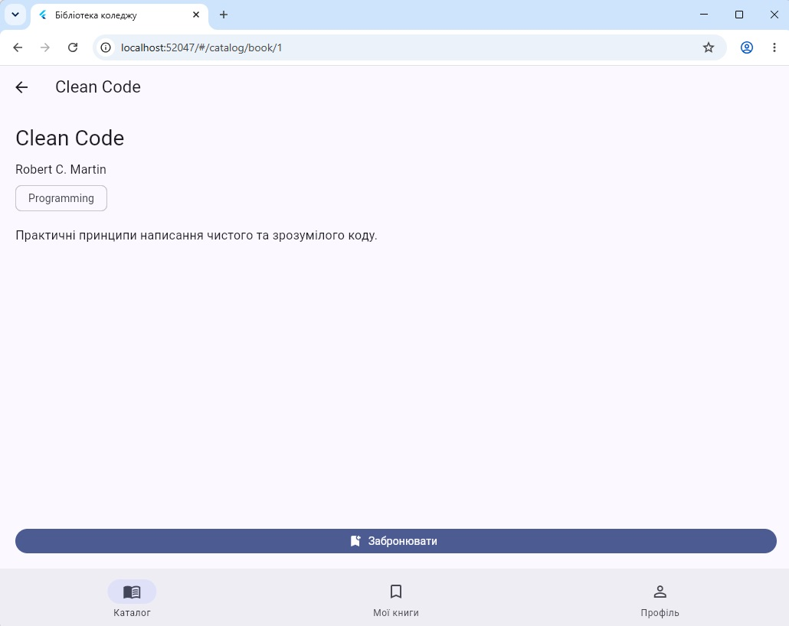
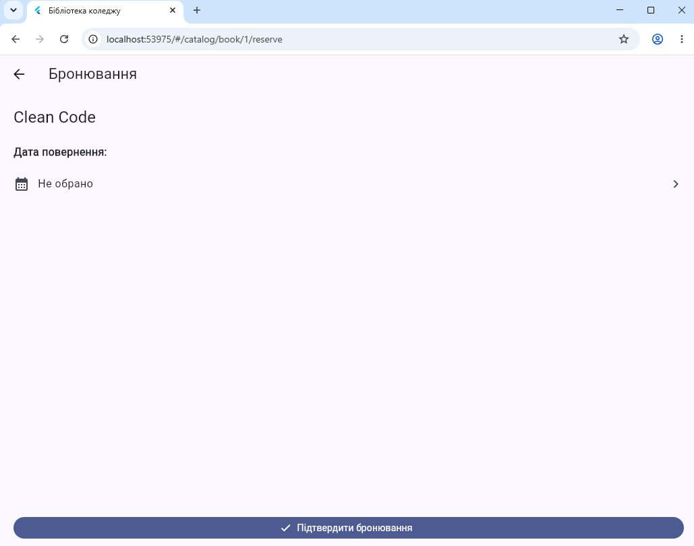
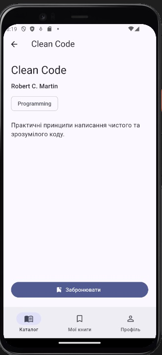

# Практична робота 7 — Роутинг і навігація у Flutter

**Студент:** Устич Максим  
**Група:** alk-43  
**Спеціальність:** 121 Інженерія програмного забезпечення  
**Варіант:** 1 — Бібліотека коледжу

## Опис проєкту

Flutter-застосунок для перегляду каталогу та бронювання книг бібліотеки коледжу.

Навігація реалізована за допомогою `go_router` 17.x.

### Реалізовано

- каталог із 15 книгами;
- фільтрацію книг за жанром;
- три вкладки: «Каталог», «Мої книги», «Профіль»;
- `StatefulShellRoute.indexedStack`;
- параметри шляху та параметри запиту;
- захищений маршрут бронювання;
- автоматичне повернення після входу;
- вибір дати повернення книги;
- повернення результату через `push/pop`;
- `PopScope`;
- `errorBuilder`;
- deep link для Android та iOS.

## Карта маршрутів

| Маршрут | Екран | Захист |
|---|---|---|
| `/catalog` | `CatalogScreen` | — |
| `/catalog?genre=...` | `CatalogScreen` | — |
| `/catalog/book/:bookId` | `BookScreen` | — |
| `/catalog/book/:bookId/reserve` | `ReserveScreen` | Потрібен вхід |
| `/my-books` | `MyBooksScreen` | — |
| `/profile` | `ProfileScreen` | — |
| `/login?from=...` | `LoginScreen` | — |
| `/return-date` | `DatePickerScreen` | — |

## Нижня навігація

Використано `StatefulShellRoute.indexedStack` із трьома вкладками:

1. Каталог
2. Мої книги
3. Профіль

Стан кожної вкладки зберігається при перемиканні.

## Guard та redirect

Бронювання книги доступне лише після входу.

Якщо гість намагається відкрити маршрут:

`/catalog/book/:bookId/reserve`

він перенаправляється на:

`/login?from=...`

Після входу користувач автоматично повертається до сторінки бронювання.

## Повернення результату

Екран вибору дати відкривається через:

```dart
context.push<DateTime>('/return-date');
```

Обрана дата повертається через:

```dart
context.pop(selectedDate);
```

## PopScope

На екрані бронювання використано `PopScope`.

Якщо користувач вибрав дату, але не завершив бронювання, при виході з'являється підтвердження.

## Deep link

Використовується схема:

```text
library://app/catalog/book/<id>
```

Приклад:

```text
library://app/catalog/book/1
```

Цей deep link відкриває книгу **Clean Code**.

### Перевірка на Android

```powershell
& "$env:LOCALAPPDATA\Android\Sdk\platform-tools\adb.exe" shell am start -a android.intent.action.VIEW -c android.intent.category.BROWSABLE -d "library://app/catalog/book/1"
```

Deep link налаштовано у:

- `android/app/src/main/AndroidManifest.xml`
- `ios/Runner/Info.plist`

## Запуск проєкту

```bash
flutter pub get
flutter analyze
flutter test
flutter run -d chrome
```

## Скріншоти

### Збереження стану вкладки



### Повернення після входу



### Deep link



## Труднощі та їх розв'язання

### Повернення після входу

Спочатку після авторизації користувач не повертався до захищеного маршруту. Проблему вирішено передаванням адреси через query-параметр `from`.

### ADB у Windows

Команда `adb` не була доступна через `PATH`, тому для перевірки deep link використано повний шлях до `adb.exe`.

## Використані технології

- Flutter
- Dart
- `go_router` 17.x
- `GoRouter`
- `StatefulShellRoute`
- `redirect`
- `refreshListenable`
- `ChangeNotifier`
- `PopScope`
- Deep Linking
- Git
